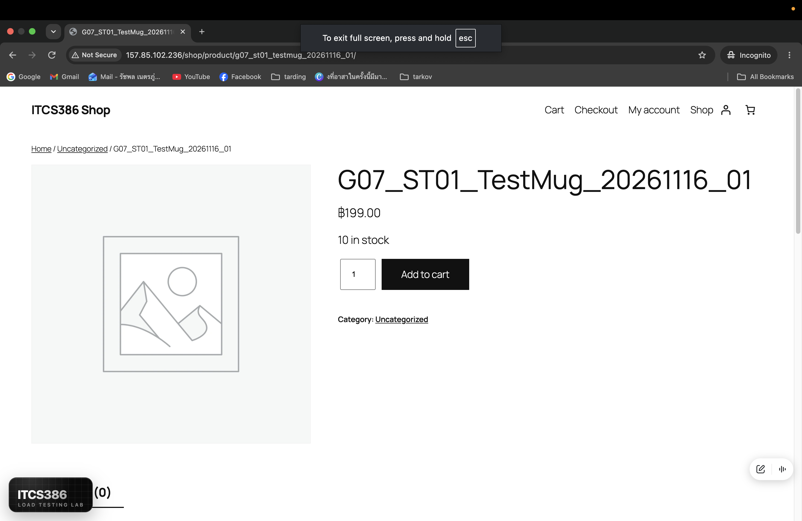
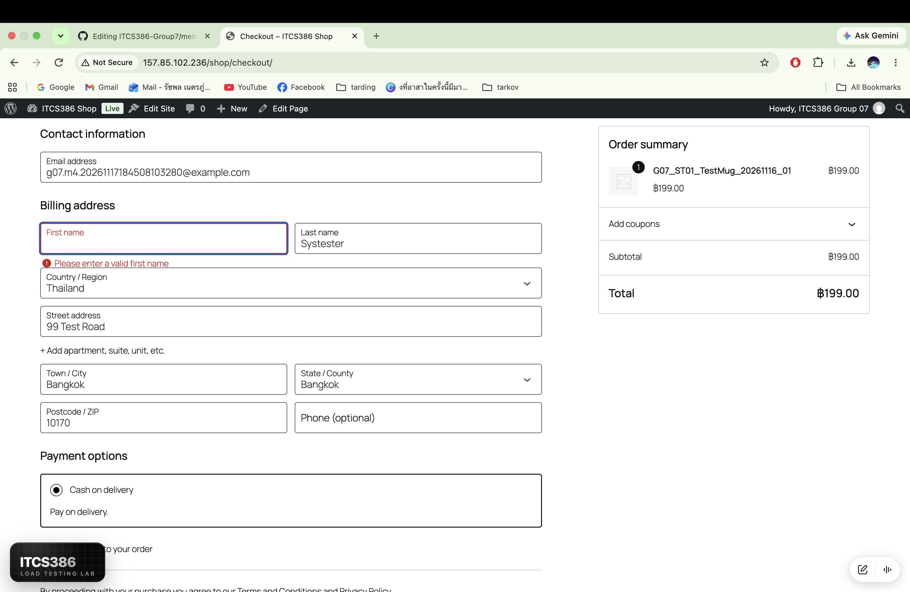
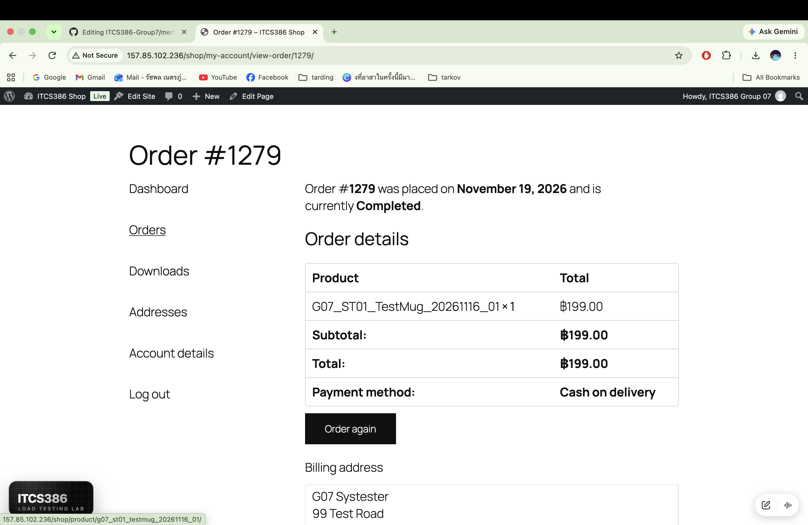
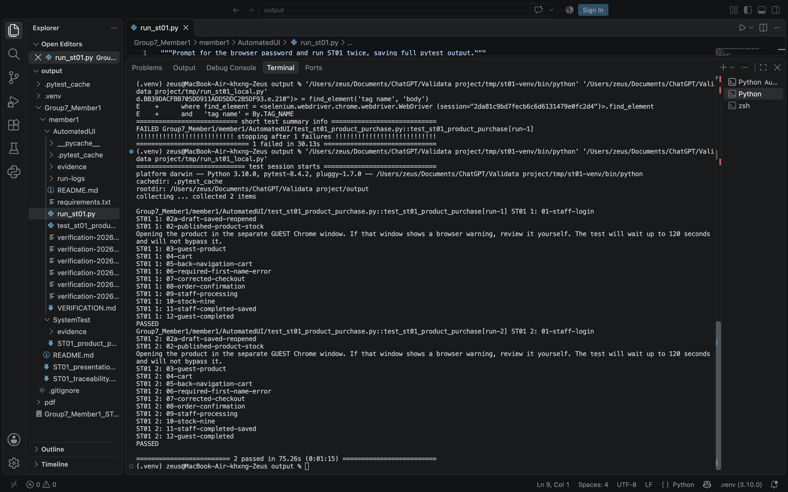

# Kong — System Testing and Automated UI Testing

## ITCS386 Project 2 — Group 7

**Scenario: ST01 — Product Purchase across Staff and Guest Views**

This scenario checks the complete purchase workflow: staff creates a product, a guest purchases one unit, stock decreases, and staff completes the order. The guest then sees the completed order.

**Recorded automated result: `2 passed in 75.26s`**

## 1. Responsibilities

1. Prepare and execute the manual ST01 system test.
2. Check the same order from staff and guest views.
3. Automate ST01 using Selenium and pytest.
4. Run the complete automated scenario twice with fresh data.
5. Collect screenshots, results, and feature coverage for the group.

## 2. Test Environment

| Item | Details |
|---|---|
| System under test | WooCommerce course lab |
| Shop | `http://157.85.102.236/shop/` |
| Staff panel | `http://157.85.102.236/shop/wp-admin/` |
| Staff account | Group 7 — `itcs386-g07` |
| Customer | Guest using fictional billing details |
| Payment method | Cash on delivery (COD) |
| Automation | Python 3.10.0, pytest 8.4.2, Selenium 4.53.0, Chrome |
| Execution platform | macOS |

Preconditions: the lab is reachable, the staff account can manage products and orders, COD is available, and staff and guest use separate browser sessions. Credentials are entered privately and are not included in this README.

## 3. Scenario and Test Data

```text
Staff creates product → Guest views product → Add to cart
→ Checkout → Validate required field → Place COD order
→ Staff checks order and stock → Staff marks Completed
→ Guest checks completed order
```

| Data | Original manual test |
|---|---|
| Product | `G07_ST01_TestMug_20261116_01` |
| Product ID | 491 |
| Unit price | THB 199.00 |
| Initial stock | 10 |
| Purchase quantity | 1 |
| Expected final stock | 9 |
| Expected total | THB 199.00 |
| Order ID | 807 |
| Final order status | Completed |

The customer used fictional information: `TestCustomer1 TestCustomer1`, `g07.st01.20261118@example.com`, and `1 Test Road, Bangkok, 10200`.

This is a **guest checkout** scenario. It does not require a registered customer or claim coverage of My Account order history.

## 4. Manual System Test

The original product/cart screenshots were captured on 16 November 2026 Bangkok time. Checkout and order screenshots were captured on 18 November. Additional checks were captured separately on 18 November at approximately 19:24–19:30 Bangkok.

| Step | Action | Expected result | Recorded result |
|---|---|---|---|
| ST01-01 | Sign in as Group 7 staff | Staff product editor is accessible | PASS |
| ST01-02 | Publish product at THB 199 with stock 10 | Published product has the intended data | PASS |
| ST01-03 | Open product as a guest | Correct name, price and stock are visible | PASS |
| ST01-04 | Add one unit and open cart | One item, quantity 1, total THB 199 | PASS |
| ST01-05 | Open checkout and go Back | Cart contents and total remain unchanged | PASS — dated follow-up |
| ST01-06 | Leave First name blank and attempt checkout | Required-field error prevents completion | PASS — dated follow-up screenshot |
| ST01-07 | Correct the billing information and place a COD order | Correct order confirmation and total | PASS — order 807 |
| ST01-08 | Open order in staff view | Same item, customer, quantity and total; Processing status | PASS |
| ST01-09 | Inspect stock reduction | Exactly one unit deducted: 10 → 9 | PASS — order note |
| ST01-10 | Change status to Completed and save | Saved Completed status | PASS |
| ST01-11 | Reopen guest order confirmation | Same order and total; completed-order message | PASS — dated follow-up |

The original run did not capture every intermediate screen. Follow-up screenshots supply the back-navigation, required-field, and guest-completion checks; they are not presented as screenshots from the original checkout. The follow-up cart item was removed without placing another order. The student performed the original manual flow; the later browser follow-up checks were performed with Codex assistance.

### Key manual evidence

**Product available to the guest — THB 199 and 10 in stock:**



**Additional manual check — 19 November 2026, logged-in session:**

The two screenshots below were supplied by the student at approximately 11:15–11:18 Bangkok. They show the Group 7 account signed in. They are separate from the original guest order 807 and the two automated runs.

**Blank First name displays “Please enter a valid first name”:**



**My Account shows order 1279 as Completed — one mug, THB 199, COD:**



These images demonstrate required-field validation and the displayed completed status for order 1279. They do not independently show its initial stock, stock reduction, or the staff status-change action. The earlier guest-completion evidence for order 807 remains available [here](SystemTest/evidence/follow-up-20261118/04-order-807-guest-completed.jpg).

Other manual evidence:

- [Published product](SystemTest/evidence/original-manual/01-product-published.png)
- [Cart](SystemTest/evidence/original-manual/03-cart.png)
- [Checkout](SystemTest/evidence/original-manual/04-checkout-guest.png)
- [Order 807 confirmation](SystemTest/evidence/original-manual/05-order-807-confirmation.png)
- [Staff Processing status](SystemTest/evidence/original-manual/06-order-807-processing.png)
- [Stock reduction and email notes](SystemTest/evidence/original-manual/07-stock-and-mail-notes.png)
- [Staff saved Completed status](SystemTest/evidence/original-manual/08-order-807-completed.png)
- [Cart preserved after Back](SystemTest/evidence/follow-up-20261118/01-back-navigation.jpg)
- [Follow-up cart cleanup](SystemTest/evidence/follow-up-20261118/03-cart-cleaned.jpg)

## 5. Automated UI Test

Test source: [test_st01_product_purchase.py](AutomatedUI/test_st01_product_purchase.py)

Runner: [run_st01.py](AutomatedUI/run_st01.py)

The test repeats the manual guest workflow using two separate Selenium browser sessions: one for staff and one for the guest. Each repetition creates a fresh product and fictional customer email using a timestamp and random suffix.

### What the code verifies

| Area | Automated checks |
|---|---|
| Staff setup | Login, save/reopen draft, publish, verify persisted status and stock 10 |
| Product view | Correct product name, price THB 199 and stock 10 |
| Cart | Exactly one product, quantity 1 and total THB 199 |
| Back navigation | Same cart after returning from checkout |
| Invalid input | Empty First name produces validation and no order confirmation |
| Valid checkout | Corrected data creates a COD order with matching details |
| Staff order | Processing status, matching product, customer and total |
| Inventory | Product stock is exactly 9 |
| Completion | Staff saves Completed, reopens the order, and verifies persistence |
| Guest confirmation | Refresh shows Order completed with the same order and total |

The script waits for actual cart and checkout content to load before checking it. It also handles the page replacement during publishing. These waits prevent loading placeholders or an old page element from being mistaken for a failed business result.

Both repetitions perform the complete workflow. **“2 passed” means two full scenario executions, not just two individual assertions.** This is functional UI testing, not a performance/load test.

## 6. Recorded Automated Results

Executed on **19 November 2026, approximately 00:53–00:54 Bangkok**, through the local VS Code terminal with Codex assistance.

```text
run-1: PASSED
run-2: PASSED

2 passed in 75.26s (0:01:15)
```

| Run | Product ID | Order ID | Total | Stock | Final status | Result |
|---|---:|---:|---|---|---|---|
| Run 1 | 1146 | 1147 | THB 199.00 | 10 → 9 | Completed | PASS |
| Run 2 | 1148 | 1149 | THB 199.00 | 10 → 9 | Completed | PASS |



- [Full passing execution log](AutomatedUI/verification-20261119-005315.txt)
- [Run 1 screenshots](AutomatedUI/evidence/run-1-20261119-005315-29eabd/)
- [Run 1 result JSON](AutomatedUI/evidence/run-1-20261119-005315-29eabd/result.json)
- [Run 2 screenshots](AutomatedUI/evidence/run-2-20261119-005356-951bc1/)
- [Run 2 result JSON](AutomatedUI/evidence/run-2-20261119-005356-951bc1/result.json)

These results demonstrate repeatability in the recorded environment. They do not establish that every WooCommerce feature or every future execution will pass.

## 7. Observation — Order Email Failure

Staff notes for the original manual order recorded:

```text
Could not instantiate mail function
```

The notification failure was observed alongside successful order creation, correct totals, stock reduction and completion. It is recorded as a **suspected lab mail-configuration issue**, not a proven WooCommerce code defect. Delivery to a real inbox was not tested; the customer email was fictional.

Evidence: [stock and mail notes](SystemTest/evidence/original-manual/07-stock-and-mail-notes.png).

## 8. How to Run

From the repository root on macOS:

```bash
cd member1/AutomatedUI
python3 -m venv .venv
source .venv/bin/activate
python -m pip install -r requirements.txt
python run_st01.py
```

Enter the Group 7 **browser login password** at the hidden prompt. Install Chrome before running. The runner executes both repetitions and saves terminal output in `run-logs/`; screenshots and JSON results are saved in `evidence/`.

For Windows PowerShell:

```powershell
cd member1/AutomatedUI
py -m venv .venv
.\.venv\Scripts\Activate.ps1
python -m pip install -r requirements.txt
python run_st01.py
```

After setup, run only one complete repetition for a shorter live demonstration:

```bash
python run_st01.py -k run-1
```

To check test discovery without creating products or orders:

```bash
python run_st01.py --collect-only
```

A normal full run creates two new Group 7 test products and two COD test orders. The script keeps them for evidence. Run only against the course lab; do not interrupt the automated browser. A collection check alone does not count as a passing test.

## 9. Feature Coverage and Limits

Covered: staff product creation, guest product view, cart addition, quantity/total checking, checkout back navigation, required billing validation, COD confirmation, staff order viewing, stock reduction, staff completion and guest completion feedback.

Not covered by ST01: product search, sorting/filtering, coupons, registration, customer login, My Account history, product deletion, API partition testing or load testing. The additional logged-in screenshot above shows one completed My Account order; it does not extend the automated ST01 coverage to account history. Other features belong to other group scenarios where applicable.

## 10. Files in This Member's Folder

```text
member1/
├── README.md                         
├── AutomatedUI/
│   ├── test_st01_product_purchase.py
│   ├── run_st01.py
│   ├── requirements.txt
│   ├── verification-20261119-005315.txt
│   └── evidence/
│       ├── 2-passed-terminal.jpg
│       ├── run-1-20261119-005315-29eabd/
│       └── run-2-20261119-005356-951bc1/
└── SystemTest/
    └── evidence/
        ├── original-manual/
        ├── follow-up-20261118/
        └── manual-20261119/
```


